# Request Lifecycle Diagrams

This document provides detailed flow diagrams for the FalcoElectrec service request lifecycle.

---

## Request Status State Machine

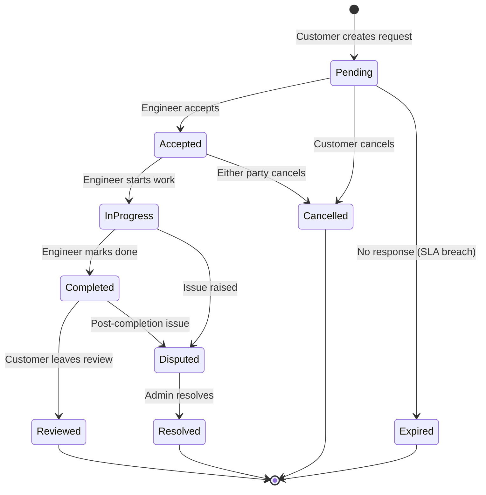

---

## Quick Request Flow (2h Response SLA)

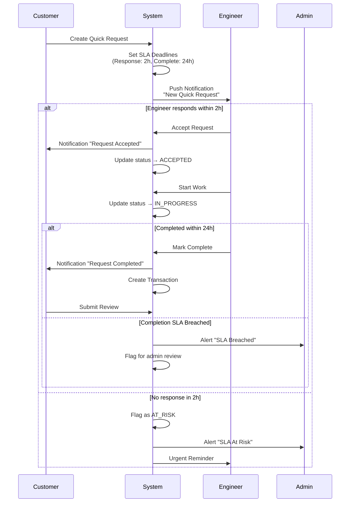

---

## Late Request Flow (24h Response SLA)

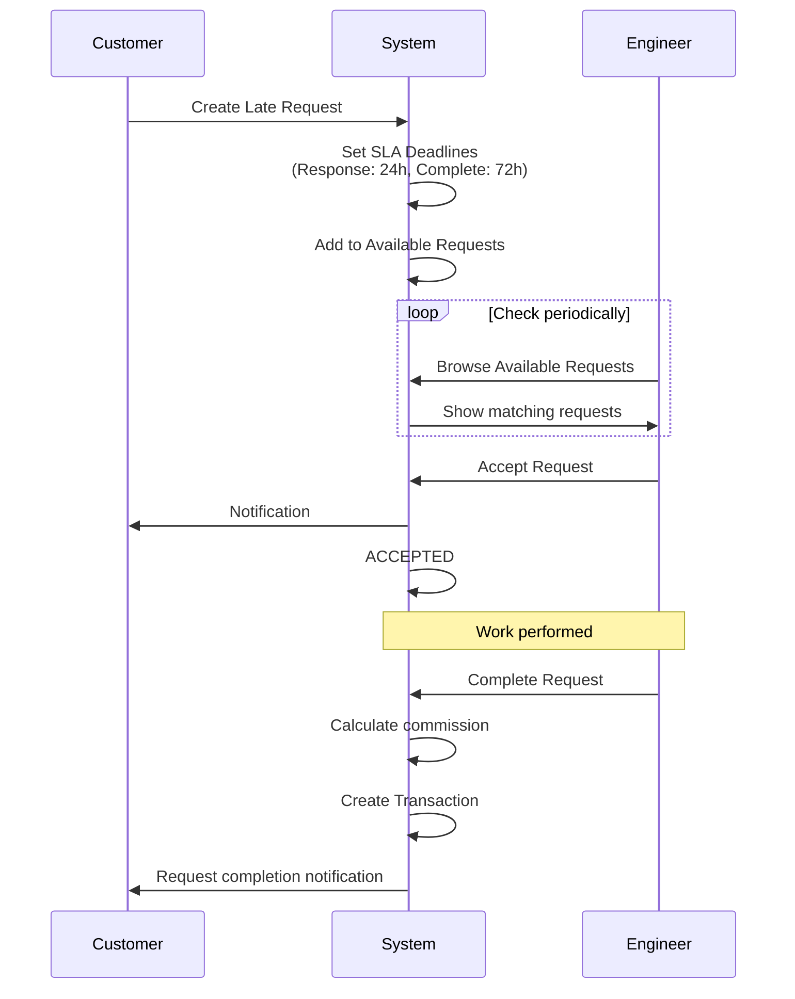

---

## Engineer Recommendation Flow

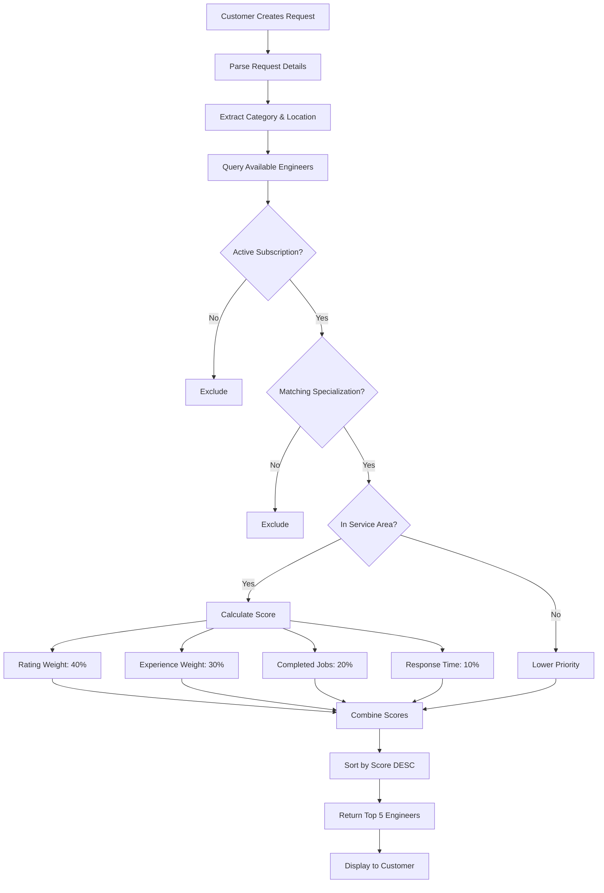

---

## SLA Monitoring Process

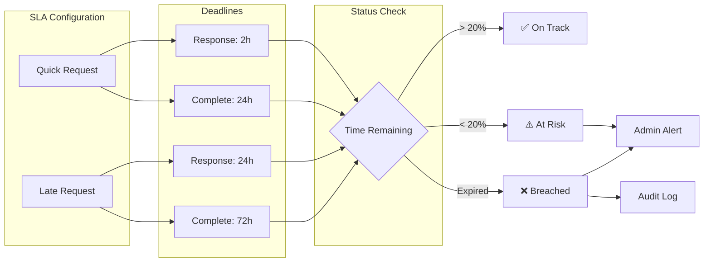

---

## Dispute Resolution Flow

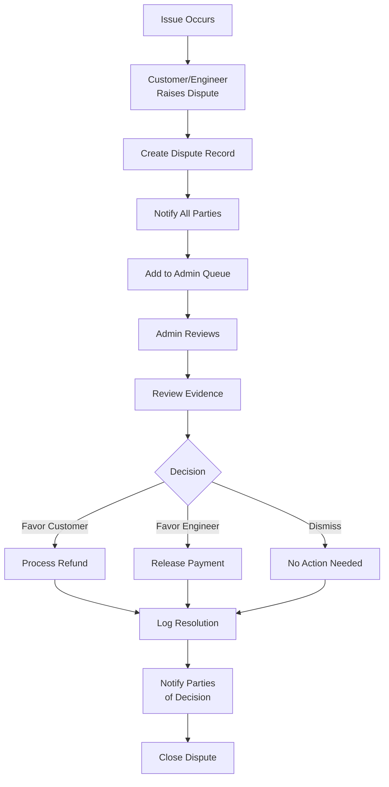

---

## Payment/Transaction Flow

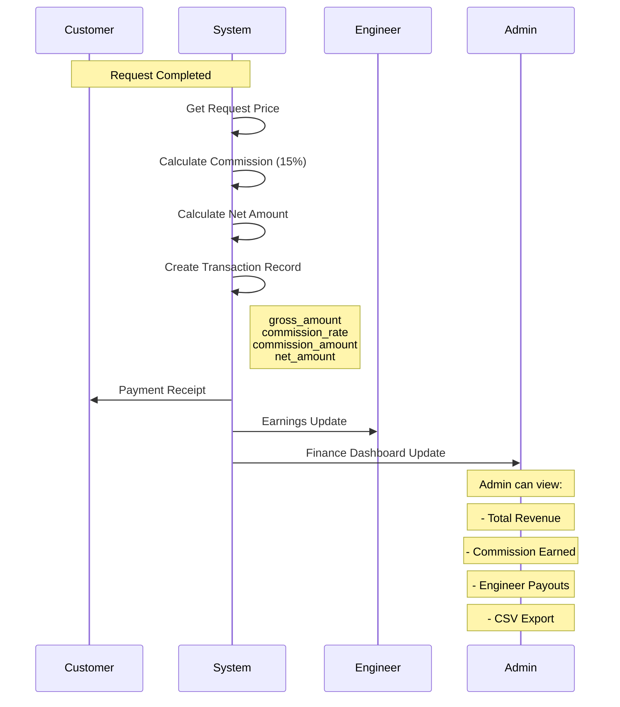

---

## Block List Flow

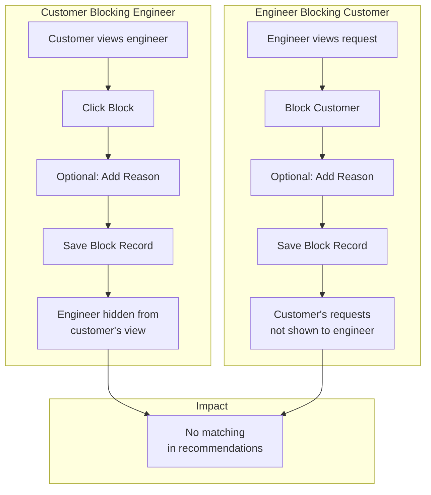

---

## Review System Flow

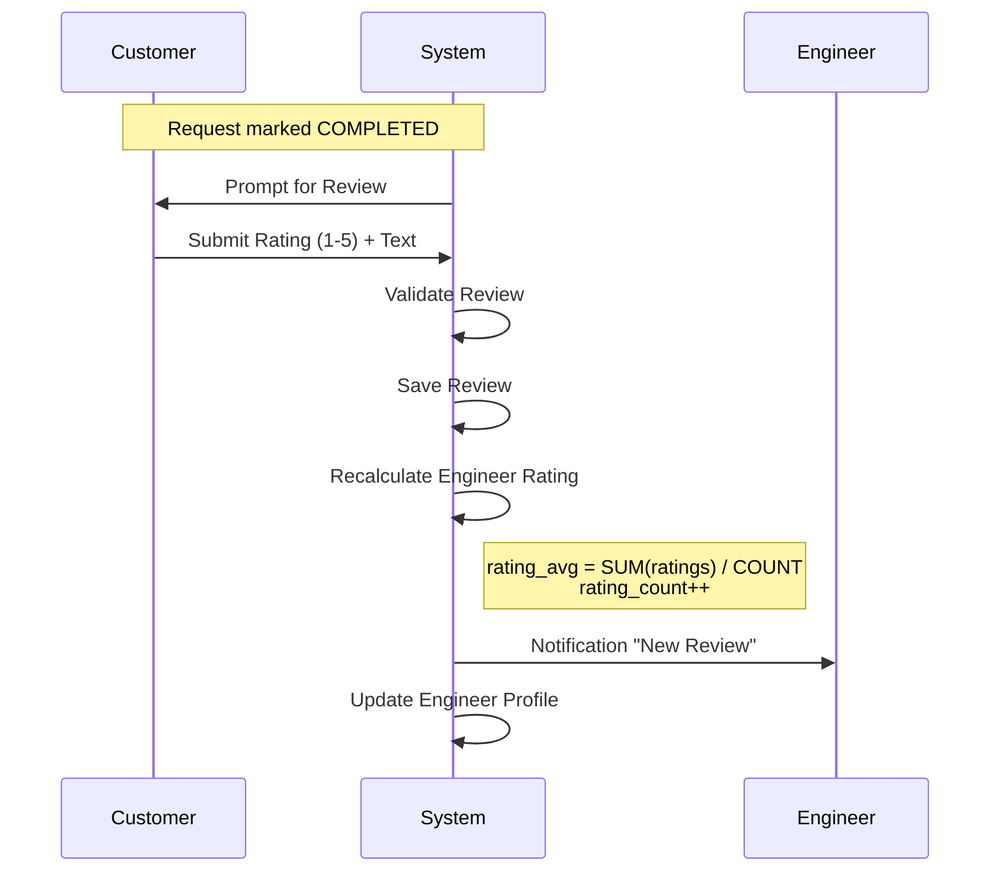

---

## Notification System

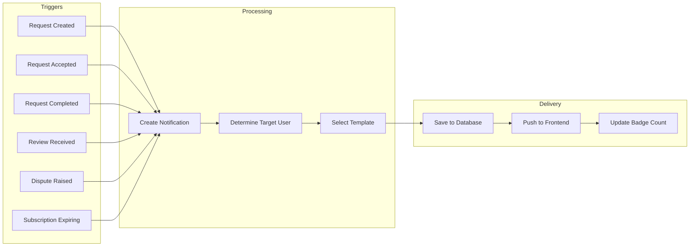

---

## Admin Dashboard Data Flow

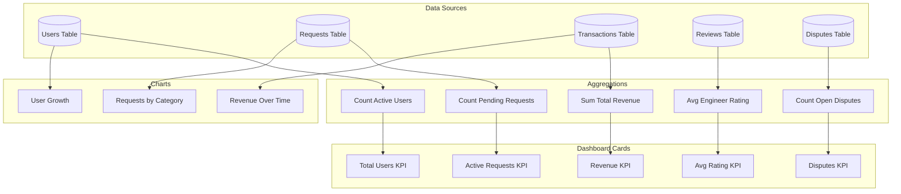

---

*These diagrams can be rendered in VS Code with the "Markdown Preview Mermaid Support" extension or on GitHub.*
